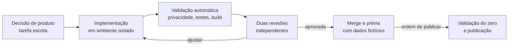
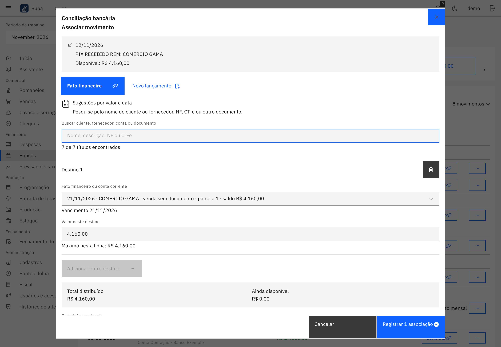
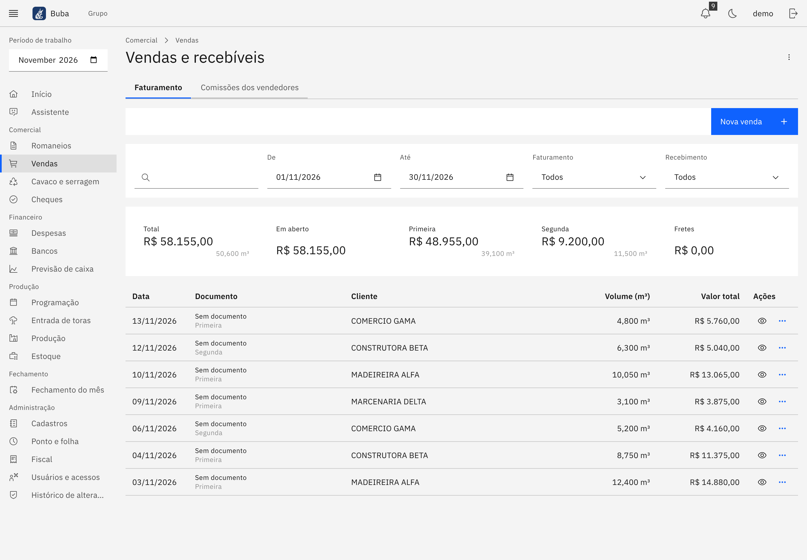
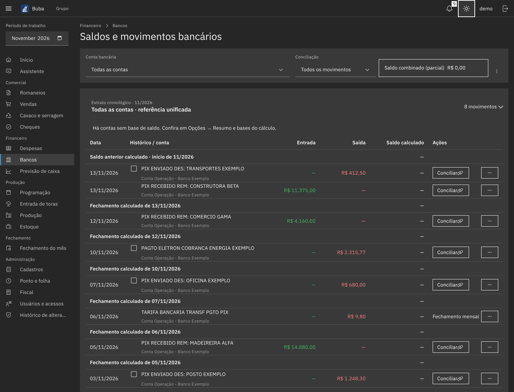
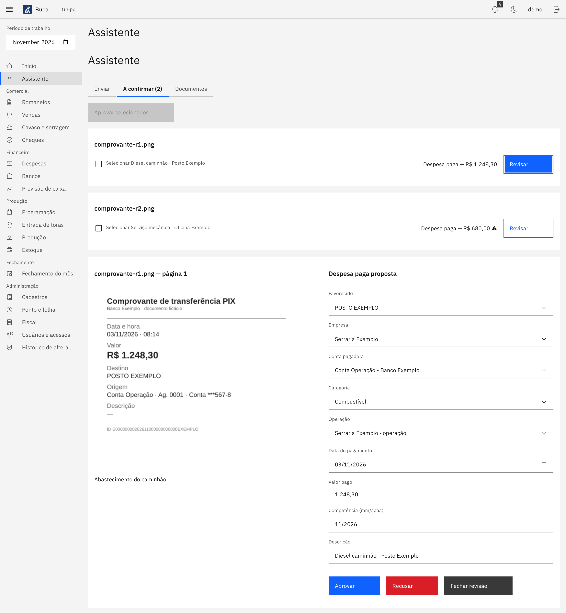

# Buba

Sistema de gestão para médias empresas com grande diversidade de regras de negócio, não atendidas por sistemas prontos.

## O problema e para quem

O Grupo CBM, uma indústria madeireira, operou por mais de dez anos com um sistema legado. Cada área tinha regras próprias: vendas de madeira e de resíduos, entrada e cubagem de toras, fretes, cheques, contas correntes, conciliação de várias contas bancárias entre empresas do grupo e fechamento mensal. Os sistemas de gestão prontos não cobriam esse conjunto.

O Buba foi construído do zero para substituir esse legado, sem interromper a operação durante a troca.

## Estado atual

- **Em produção** desde agosto de 2026, num servidor na nuvem, acessado por rede privada.
- **Quem usa:** dois usuários ativos no Grupo CBM, na operação diária.
- **Já roda no Buba:** vendas e recebíveis, romaneios, despesas, conciliação bancária, cheques, fretes, toras, produção e estoque, previsão de caixa. O assistente de lançamento foi publicado em novembro de 2026, ainda sem uso em operação.
- **Ainda convive com o legado:** o fechamento mensal segue conferido contra o legado; a folha oficial continua com o contador (o Buba gera o recibo previsto); a emissão fiscal está bloqueada até homologação.

## O que o sistema faz

- **Comercial:** romaneios, vendas de madeira com parcelas e comissões, vendas de cavaco e serragem com conta corrente por cliente, controle de cheques.
- **Financeiro:** despesas, obrigações a pagar, extratos de várias contas, conciliação bancária com sugestão por valor e data, previsão de caixa.
- **Produção:** entrada de toras, programação, produção e estoque.
- **Fechamento do mês:** preparação em etapas, assinatura e abertura do mês seguinte.
- **Pessoal:** ponto e folha prevista.
- **Assistente de lançamento:** o usuário envia comprovantes, boletos, notas fiscais e fotos de romaneios; um modelo de linguagem monta o pré-lançamento e nada entra nos livros sem aprovação humana.
- **Pendências:** um painel mostra o que falta conciliar e confirmar.

## Como foi construído

Construo o Buba usando o [ODP](https://github.com/AndreLSPortella/odp), um fluxo de desenvolvimento que montei para levar cada tarefa do pedido até a produção:

- **Arquitetura:** monolito modular, com 29 módulos de domínio no backend e regras de dependência verificadas por testes de arquitetura.
- **Integridade no banco:** gatilhos exigem trilha de auditoria em cadastros e lançamentos; estornos desfazem exatamente o efeito original.
- **Papel do ODP:** agentes de IA implementam e revisam as tarefas dentro de limites impostos por código; decisões de produto, regras de negócio e a ordem de publicar são minhas.

## A migração do legado

A troca foi feita com a empresa em operação. Durante o período paralelo, o legado é a referência de conferência, e desligá-lo numa área exige definir a abertura e o histórico dela. As contas correntes, por exemplo, foram conferidas com o legado até 31/07/2026 e fecharam com diferença zero.

O mais difícil:

- **Histórico:** os faturamentos e títulos antigos foram importados como histórico, sem gerar lançamentos duplicados quando o mesmo fato já existe no sistema.
- **Banco de dados:** o banco de produção tem uma linhagem de migrações própria. O código atual vive num repositório novo, sem nenhum dado operacional, e as duas linhagens convivem sem renumerar nem reescrever o histórico.
- **Regras implícitas:** muitas regras só existiam na prática de quem operava o legado (critérios de classificação, cheques, fretes). Cada uma foi registrada no documento de regras de negócio, com identificador, data e origem.

## Números

- **Período:** 21/09/2026 a 16/11/2026 neste repositório, com 807 commits.
- **Tarefas:** 144 concluídas pelo fluxo automático desde 22/10/2026.
- **Publicações em produção:** 23.
- **Módulos:** 29 no backend; 19 telas no menu principal.
- **Testes:** 773 de frontend e 506 de backend, incluindo 36 suítes de integração com banco real.

## Capturas de tela

Ambiente local com dados fictícios.

**Conciliação: o movimento do banco já chega com a parcela de venda sugerida**

**Vendas e recebíveis do mês**

**Extrato bancário no modo escuro**

**Assistente: pré-lançamento de um comprovante, com o documento ao lado da proposta**

## Decisões relevantes

1. **A IA sugere, o humano confirma.** Lançamentos, baixas e conciliações só acontecem com confirmação, porque erros financeiros são caros de desfazer.
2. **Legado como referência até bater.** Nenhuma área sai do legado sem conferência, para a operação não depender de um sistema ainda não verificado.
3. **Nenhum dado real no repositório.** Um verificador de privacidade roda antes de cada commit e os testes usam dados fictícios.
4. **Publicação só com validação do zero.** O commit é clonado numa pasta nova e todos os testes rodam de novo antes de ir para produção.
5. **Cortar o que não é usado.** Funções pouco usadas são removidas em vez de remendadas, para manter o sistema pequeno e mantível.

## Tecnologia

Java 25 · Spring Boot 4.1 · PostgreSQL 18 · Flyway · ArchUnit · React 19 · TypeScript · Vite · Carbon Design System · Docker

## Sobre o código

O repositório do Buba é privado; este repositório é uma vitrine pública, sem código-fonte.
